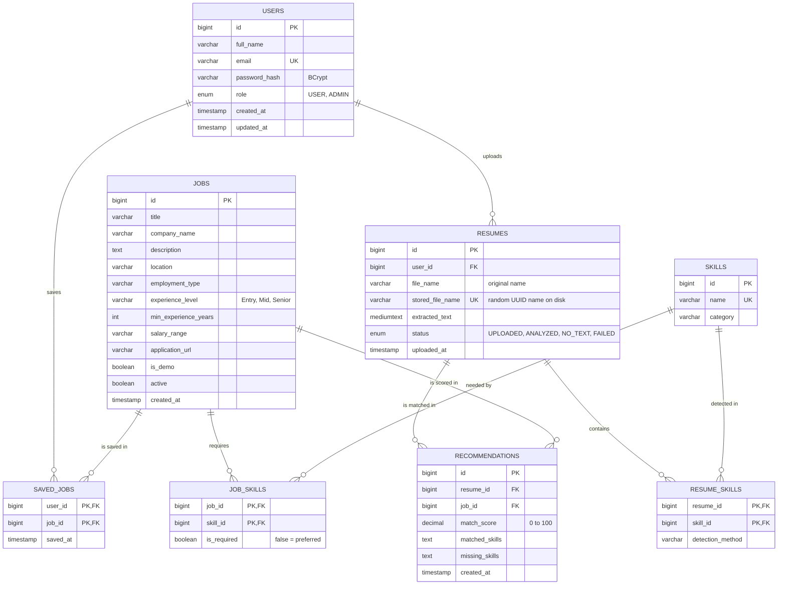

# ER Diagram

Source of truth: `database/schema.sql`. To get an image for a report, paste the Mermaid block into https://mermaid.live and export PNG/SVG. GitHub and VS Code (Markdown Preview Mermaid Support) also render it directly.

## Design notes
- `RESUME_SKILLS`, `JOB_SKILLS` and `SAVED_JOBS` are junction tables with composite primary keys, so a pair can exist only once.
- Every foreign key uses `ON DELETE CASCADE`: deleting a user removes their resumes, saved jobs and recommendations; deleting a job removes its skills, recommendations and saved entries.
- `users.email` is unique (login identity). `resumes.stored_file_name` is unique and random, so uploaded files never collide or reveal the original name on disk.
- `RECOMMENDATIONS` is a stored snapshot of the last job analysis of a resume; re-analyzing replaces that resume's rows.
- Indexes: jobs by `active`, `title`, `company_name` and (`location`, `experience_level`, `employment_type`); recommendations by (`resume_id`, `match_score`).
